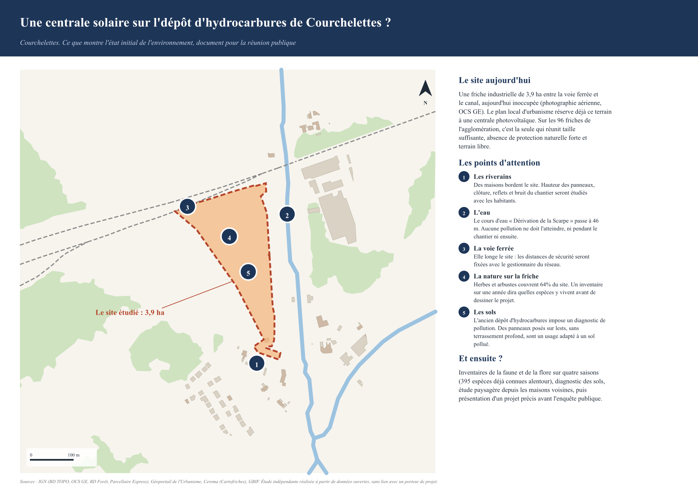
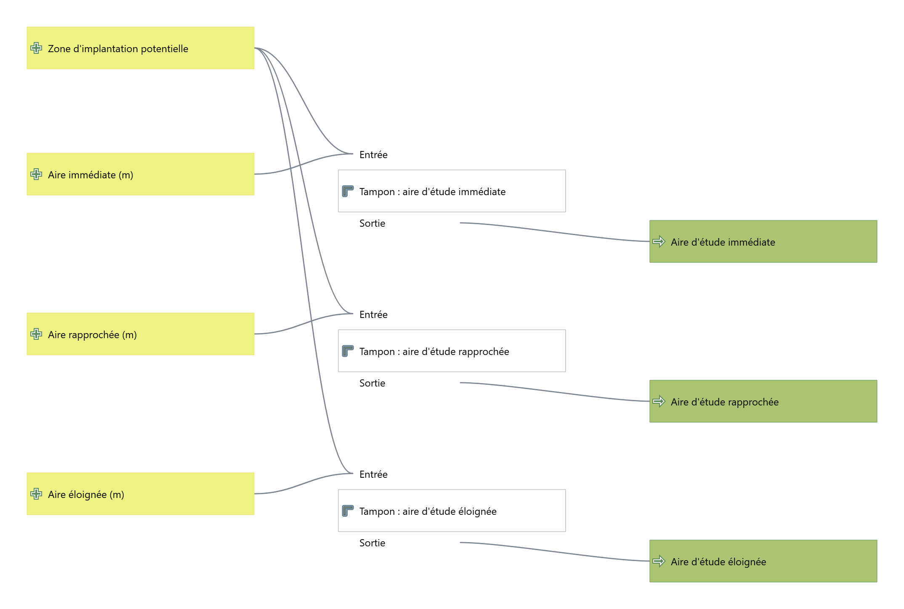
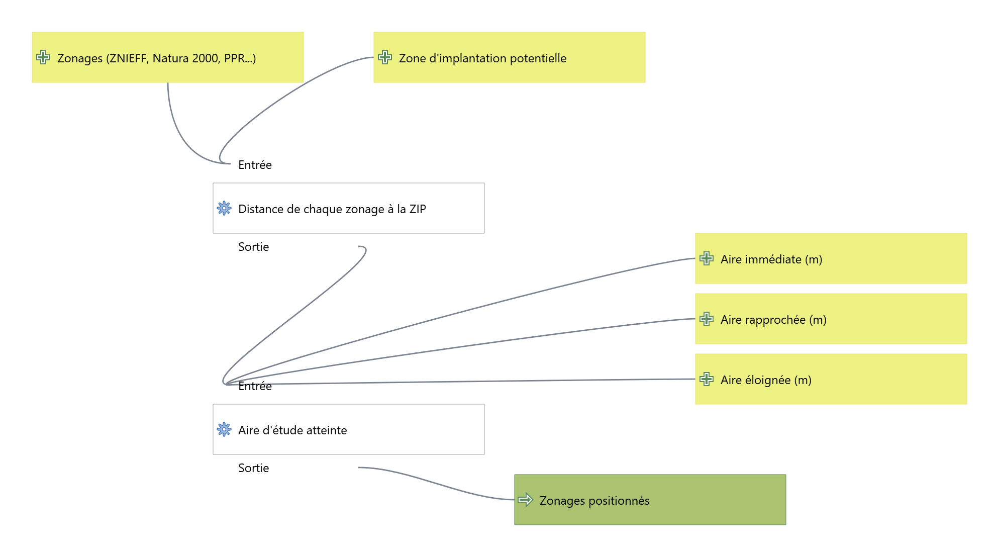
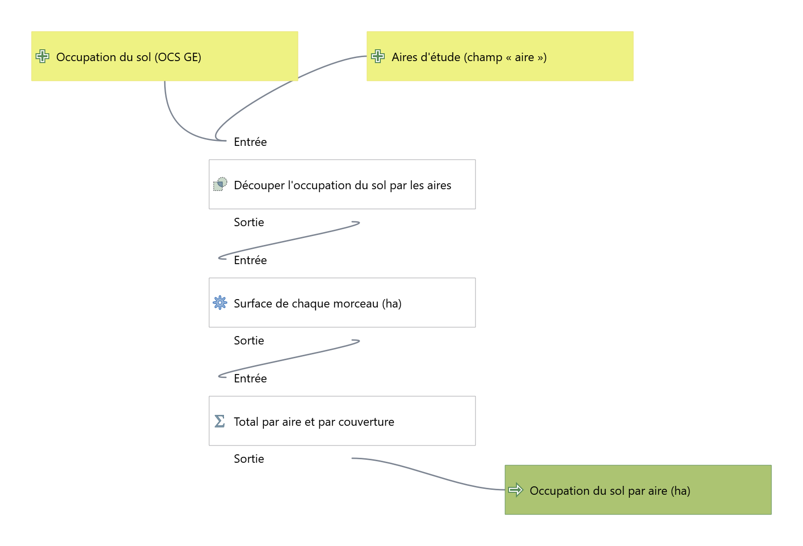
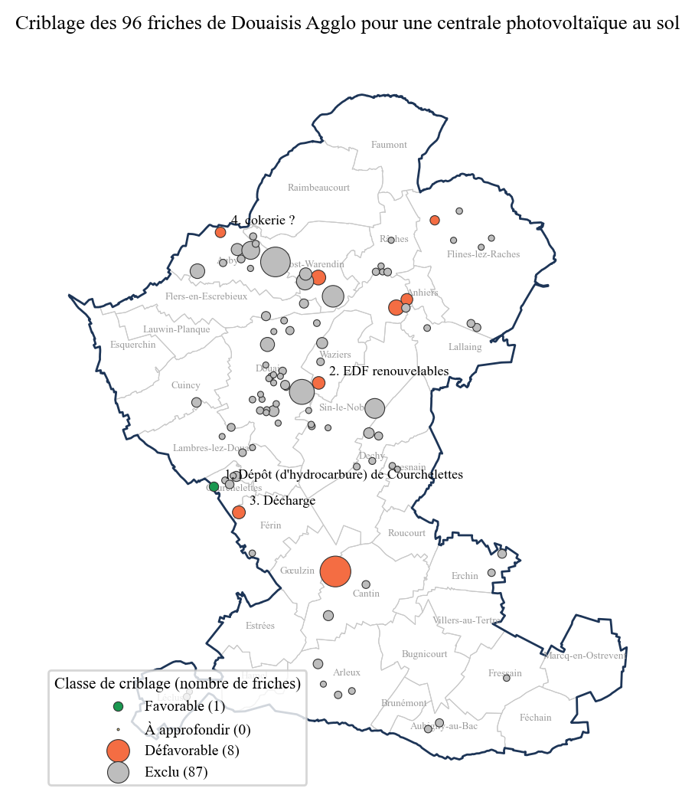
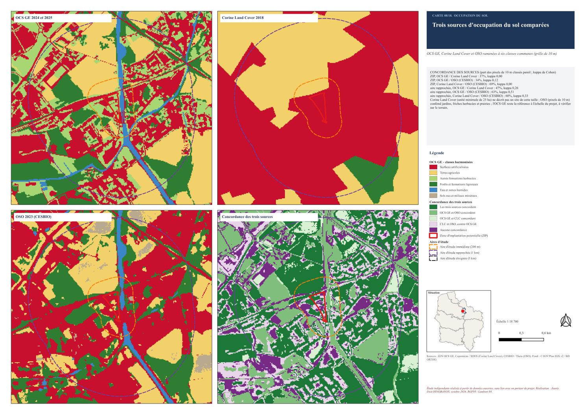
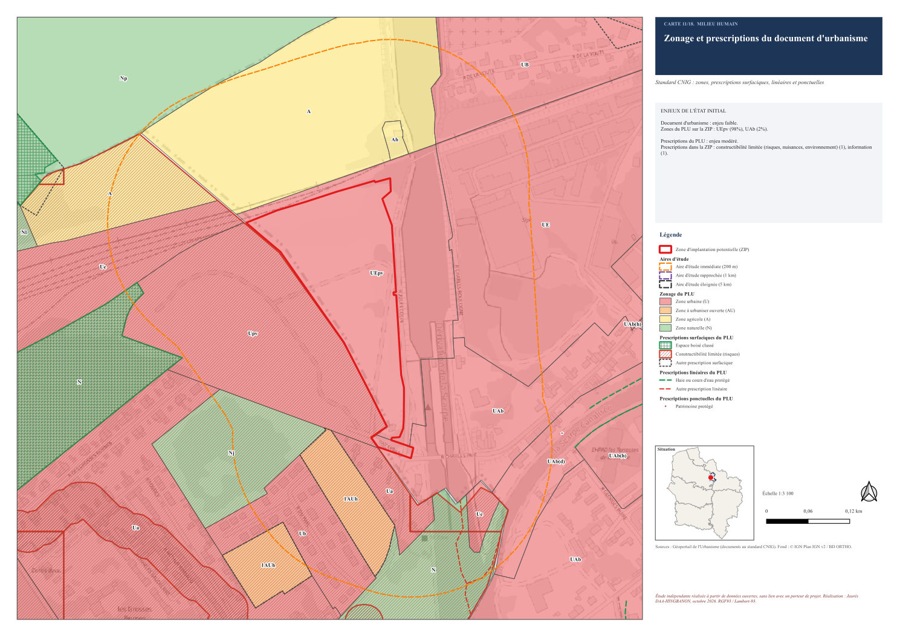

# État initial de l'environnement : outil SIG et étude de cas dans le Douaisis

Avant un projet soumis à étude d'impact, le bureau d'études décrit le site et ses abords : milieux naturels, eau, sols, risques, paysage, urbanisme, foncier, voisinage. La plupart des cartes reviennent d'un dossier à l'autre. Ce projet automatise cette partie du travail.

- **Un criblage** des friches de Douaisis Agglo, en SQL dans PostGIS, désigne le site où une centrale photovoltaïque au sol a le plus de sens.
- **Une bibliothèque Python** (`etat_initial/`) calcule les aires d'étude d'un périmètre et interroge une cinquantaine de sources ouvertes. Elle hiérarchise ensuite les enjeux et compose un atlas A3 avec PyQGIS.
- **Une extension QGIS** applique la même méthode à n'importe quel polygone en France métropolitaine.
- **Des livrables de bureau d'études** sont produits : note méthodologique, atlas de 18 cartes, GeoPackage et géodatabase, projet QGIS, tableur, projet QField pour les écologues, planche de concertation Inkscape et carte web.

> **Carte interactive :** [ouvrir la carte web](https://jauresmas.github.io/etat-initial-douaisis/)
> **Documents :** [note méthodologique](livrables/01_Documents/01_Note_methodologique.pdf), [bordereau de livraison](livrables/01_Documents/00_Bordereau_de_livraison.pdf), atlas complet en [release](https://github.com/jauresmas/etat-initial-douaisis/releases)



## Chiffres clés

| | |
|---|---|
| Friches criblées sur Douaisis Agglo | **96**, une seule classée favorable |
| Friches de plus de 3 ha déjà reconverties, écartées par l'usage OCS GE | **15** |
| Site étudié | ancien dépôt d'hydrocarbures de Courchelettes, **3,9 ha** |
| Couches interrogées par flux | **37** (IGN, INPN, BRGM, Géo2France), plus le Géoportail de l'Urbanisme, l'OCS GE, l'OSO, GBIF et TAXREF |
| Enjeux hiérarchisés | **27** : 2 forts, 6 modérés, 9 faibles, 10 nuls |
| Espèces connues dans l'aire rapprochée | **395**, dont 34 protégées et 20 patrimoniales |
| Atlas | **18** cartes A3 au même gabarit |
| Code | environ 5 600 lignes (Python, SQL, PyQGIS), 17 tests automatiques |

Le criblage aboutit à une coïncidence frappante. Le PLU de Courchelettes classe déjà 98 % du site en secteur **UEpv**, « destiné à accueillir les installations et équipements nécessaires à la création d'une centrale photovoltaïque ». Conduit avec les seules données ouvertes, le criblage retrouve un choix déjà inscrit par la collectivité.

## Ce que le projet démontre

| Compétence attendue d'un cartographe en bureau d'études | Où la trouver |
|---|---|
| Cartographies pour l'environnement, la biodiversité et l'urbanisme | Atlas de 18 cartes A3 ([`etat_initial/atlas_planches.py`](etat_initial/atlas_planches.py)), gabarit unique : titre, encadré des enjeux, légende filtrée, situation, échelle, sources |
| Bases PostgreSQL : veille, recueil, actualisation | Base dédiée en schémas `ref`, `meta`, `criblage` et `etude`, avec rôles, déclencheurs et catalogue. Le script de veille ([`09_veille.py`](scripts/09_veille.py)) compare chaque couche au flux et journalise les changements |
| Programmer des outils géomatiques | La bibliothèque `etat_initial/`, l'extension QGIS ([`extension/`](extension/etat_initial_qgis)) et la chaîne `scripts/` |
| Occupation des sols (OCS GE, Corine Land Cover, CESBIO) | Les trois sources ramenées à six classes, avec accord et kappa de Cohen ([`ocsol.py`](etat_initial/ocsol.py)). L'usage OCS GE sert au contrôle des friches |
| Fichiers fonciers et cadastre | Parcellaire Express et fichier DGFiP des personnes morales. Les propriétaires privés ne sont pas nommés |
| Standards CNIG des documents d'urbanisme | Zonage, prescriptions et informations du standard CNIG lus sur le GPU, document applicable par commune (PLU, PLUi, carte communale, RNU) |
| QGIS, ArcGIS Pro, QField | Projet QGIS symbolisé, trois modèles du modeleur graphique, géodatabase fichier pour ArcGIS Pro, projet QField avec formulaires et contrôles de saisie |
| Python et SQL | La chaîne complète. Le criblage est une vue SQL pilotée par une table de règles ([`03_criblage.sql`](sql/03_criblage.sql)) |
| DAO et supports de concertation | Planche A3 en SVG à calques, retouchable dans Inkscape et exportée par Inkscape en ligne de commande |
| Données massives, IA, web | OSO national (5,6 Go) lu en flux, OCS GE produite par apprentissage profond et confrontée aux autres sources, carte MapLibre |
| Rigueur sur les données sensibles | Contrôle des friches, relevés de terrain contrôlés avant import, foncier non nominatif, tests automatiques |

## La démarche

Les traitements ont été réalisés avec les outils de QGIS : tampons, jointure par plus proche voisin, intersections, statistiques par catégorie, mises en page et atlas. Trois modèles du modeleur graphique enchaînent les calculs clés (`livrables/02_Donnees_SIG/modeles/`, aussi intégrés au projet). Les mêmes traitements sont reproduits en Python : la chaîne relance toute l'étude en une commande, en sept minutes environ une fois les données téléchargées, et redonne les mêmes résultats. Un contrôle croisé ([`06b_modeles_qgis.py`](scripts/06b_modeles_qgis.py)) compare les deux voies : au plus 0,03 ha d'écart sur les aires d'étude, 0,3 m sur les distances des zonages et 0,01 ha sur les surfaces d'occupation du sol.

<p align="center">



</p>
<p align="center"><i>Les trois modèles du modeleur graphique : aires d'étude, position des zonages, occupation du sol par aire.</i></p>

1. **Référentiel territorial** ([`01_referentiel.py`](scripts/01_referentiel.py)). Il couvre Douaisis Agglo et une marge de 5 km : 36 couches, 65 000 objets, chargés dans PostGIS avec leur empreinte de contrôle.
2. **Criblage** ([`03_criblage.sql`](sql/03_criblage.sql)). Chaque friche est exclue, pénalisée ou favorisée selon 17 critères. Le premier site retenu à l'origine était une plateforme logistique construite entre 2021 et 2025 : la photographie aérienne et l'OCS GE différentielle l'ont révélé. Le critère « site déjà reconverti », fondé sur l'usage OCS GE, est né de ce contrôle.

   

3. **Collecte** ([`03_collecte_site.py`](scripts/03_collecte_site.py)). Toutes les couches sont interrogées sur leur aire d'étude (immédiate 200 m, rapprochée 1 km, éloignée 5 km). L'OCS GE est prise sur chaque département touché, ici le Nord (2025) et le Pas-de-Calais (2024).
4. **Analyses et enjeux** ([`etude.py`](etat_initial/etude.py), [`enjeux.py`](etat_initial/enjeux.py)). Elles produisent l'inventaire des zonages, l'occupation du sol et son évolution, la comparaison des trois sources, l'urbanisme, les servitudes, le foncier, les risques, les réseaux et les espèces avec leurs statuts TAXREF. La grille classe 27 sujets de « nul » à « très fort ». Chaque règle est écrite dans le tableur.
5. **Livrables** : atlas, note, données, tableur, QField, planche de concertation, carte web.

<p align="center">


</p>

## Livrables

| Dossier | Contenu |
|---|---|
| `livrables/01_Documents/` | Bordereau de livraison, note méthodologique (7 pages) |
| `livrables/02_Donnees_SIG/` | GeoPackage (couches et tableaux), projet QGIS (18 mises en page, thèmes, modèles), modèles du modeleur graphique, rasters ; géodatabase fichier pour ArcGIS Pro en release |
| `livrables/03_Atlas/` | Atlas A3 complet et chaque carte en PDF (publiés en release) |
| `livrables/04_Tableaux/` | Classeur Excel : enjeux, zonages, occupation du sol, urbanisme, foncier, risques, espèces |
| `livrables/05_Concertation/` | Planche de réunion publique : SVG Inkscape à calques, PDF, PNG |
| `livrables/06_Terrain/` | Projet QField des inventaires (observations, habitats EUNIS, liste des espèces connues) |
| `livrables/07_Extension_QGIS/` | Extension installable (publiée en release) |
| `docs/` | Carte web (GitHub Pages) et aperçus des cartes |

## Outils réutilisables

**Extension QGIS « État initial ».** Dans QGIS, ouvrir *Extensions > Installer depuis un ZIP* et choisir `etat_initial_qgis.zip`. L'algorithme *Produire l'état initial d'un périmètre* apparaît dans la boîte à outils et dans la barre d'outils. Il prend un polygone, un type de projet (photovoltaïque, éolien, aménagement) et un dossier, puis produit le GeoPackage, le projet QGIS et les 18 planches. Il a été essayé sur une autre friche du territoire ([`tests/essai_extension_qgis.py`](tests/essai_extension_qgis.py)).

**Terrain.** Le projet QField (`livrables/06_Terrain/qfield/`) se copie sur la tablette ou s'empaquette avec QFieldSync. Au retour, [`10_import_terrain.py`](scripts/10_import_terrain.py) contrôle les relevés (champs obligatoires, date, position, doublons). Il verse les relevés valides dans la base, où un déclencheur refuse toute observation hors de l'aire d'étude, et liste les anomalies dans un rapport.

**Veille.** `python scripts/09_veille.py` signale les couches modifiées chez leur producteur. Avec `--appliquer`, il les recharge et recalcule le criblage.

## Reproduire

Prérequis : Python 3.10 ou plus, PostgreSQL 15 avec PostGIS 3, QGIS 3.34 et Inkscape 1.x (pour la planche).

```bash
pip install -r requirements.txt
python scripts/run_all.py
```

La chaîne crée sa propre instance PostgreSQL (port 5435, dans `data/pgdata`). Elle télécharge environ 500 Mo de données (OCS GE, OSO, fichier DGFiP) et produit tous les livrables en 25 minutes environ. Pour un autre territoire, il suffit de changer `EPCI_SIREN` et `DEPARTEMENT` dans [`scripts/config.py`](scripts/config.py). Les tests se lancent avec `python -m pytest tests`.

## Limites

- La hiérarchisation est **indicative**. Les inventaires faune-flore sur un cycle complet et la délimitation des zones humides (sol et végétation) restent indispensables.
- Les données GBIF sont opportunistes et ne remplacent pas une extraction des bases naturalistes régionales.
- Les fichiers fonciers ne sont pas ouverts : en mission, ils s'obtiennent sous convention.
- Le service des installations classées du BRGM était indisponible lors de la production.
- Les aires d'étude sont des distances fixes. Une analyse de visibilité sur modèle de terrain affinerait l'aire éloignée pour le paysage.

## Sources

IGN (ADMIN EXPRESS, BD TOPO, BD Forêt v2, Parcellaire Express, OCS GE 2.0, RPG 2024, BD ORTHO, Plan IGN v2) ; INPN / PatriNat ; MNHN (TAXREF) ; GBIF ; Géo2France (zones à dominante humide, Mission Bassin Minier, Cartofriches du Cerema) ; BRGM / Géorisques ; Géoportail de l'Urbanisme ; DGFiP ; Copernicus / SDES (Corine Land Cover) ; CESBIO / Theia (OSO 2023). Les données sont sous Licence Ouverte 2.0 ou sous les licences de leurs producteurs.

## Statut et licence

Étude indépendante réalisée à partir de données ouvertes, sans lien avec un porteur de projet. Le code est sous licence [MIT](LICENSE).

Réalisation : Jaurès DAA-HINGBANON, octobre 2026
